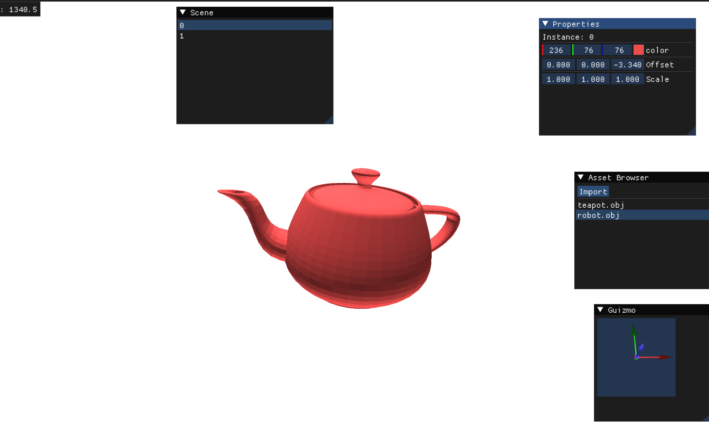
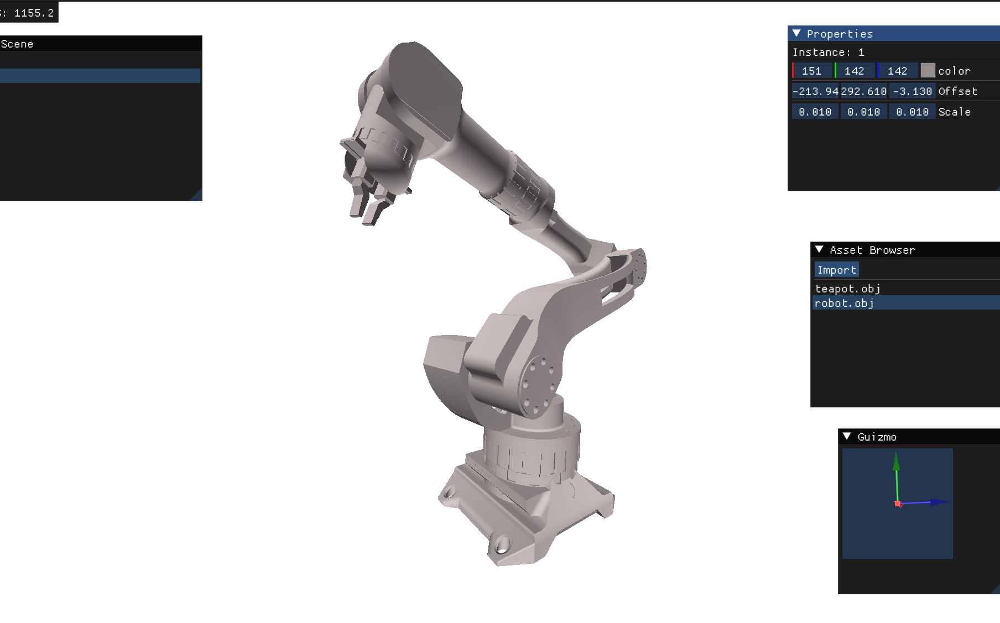

# Rendr

A C++ lightweight library for low-overhead rendering. The focus is explicit GPU memory handling, batched draws, and streaming-friendly updates — not ray tracing or a full graphics engine.

CPU writes go directly into persistently mapped buffers. Meshes share a single vertex/index arena, instance data lives in SSBOs, and the frame is submitted with one `glMultiDrawElementsIndirect` call. Windowing and context setup stay on the application side; the bundled editor is just for demo purposes.

Meshes reserve a fixed instance capacity at `create_mesh(geom, capacity)` so instance SoA ranges never collide across meshes. Global instance storage is capped by `kGlobalInstanceCapacity` (currently 150k).

Note: Vulkan rewrite is in progress since this project feels like a fight against the OpenGL api at this point.

---

## OBJ Model Loading

  

---

The editor demo runs a procedural **cosmic vortex**: ~150k instanced cubes with offsets/colors updated each frame, and a camera orbiting at a fixed distance.

**Note:** That animation loop lives in `editor/main.cpp` — it is demo/application code, not part of the renderer. On my machine it is the current bottleneck; the library’s multi-draw path is not.
